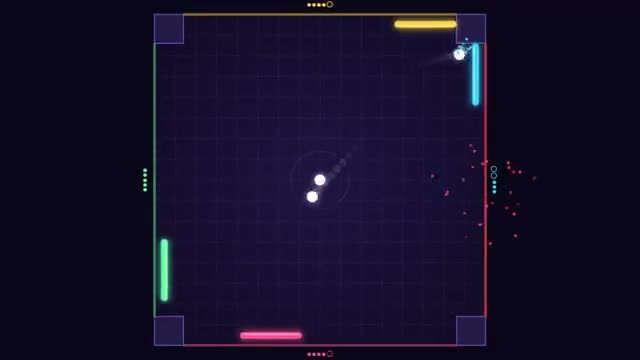

# Quad Pong

Four walls, four paddles, more balls. Last one in wins. A multiplayer starter game from [Multiplayer Agent](https://multiplayeragent.com): 2D, party, 2–4 players, with bots that guard every empty wall.

## How it plays

Slide your paddle along your wall and bounce every ball away. Let one past and you lose a life; lose all 3 and your wall closes. A new ball joins every 15 seconds.

**Controls:** Mouse or ← → to slide your paddle · touch: drag.

## Make it yours in the Game Builder

Open the [Game Builder](https://multiplayeragent.com), choose **Start from a starter game** and pick Quad Pong. It opens as version 1 in your studio, ready to play and publish. Then ask for changes, for example:

- Make the paddles shrink each time you lose a life
- Add a power-up ball that splits in two
- Turn it into an ice rink with pucks

## Run it yourself

1. Get a free publishable key (`pk_…`) at [multiplayeragent.com](https://multiplayeragent.com).
2. In `index.html`, put it in place of `pk_REPLACE_ME` in the `MP_CONNECT` block.
3. Open `index.html` in a browser. No build step and no server needed.

Without a key it still runs, offline against bots.

## How it is built

- One `index.html`. The comment at the top of the script maps the code and explains the multiplayer.
- **Host-run physics:** One player's browser moves the balls and counts lives, so everyone sees the same bounces; if it leaves, the next player takes over. Your own paddle's hits are decided on your screen, so a save you see is a save.
- **Bots:** Bots guard every empty wall, and take over the wall of anyone who leaves. Someone who joins mid-match takes over a bot's wall.
- **Leaderboard:** Most wins, for every player.
- **Live sync:** Every paddle and ball moves for everyone at once.
- Everyone sees the arena turned so their own wall is at the bottom.
- `?attract` runs it offline, four bots and three balls. The preview video is recorded from it.

## License

MIT.
